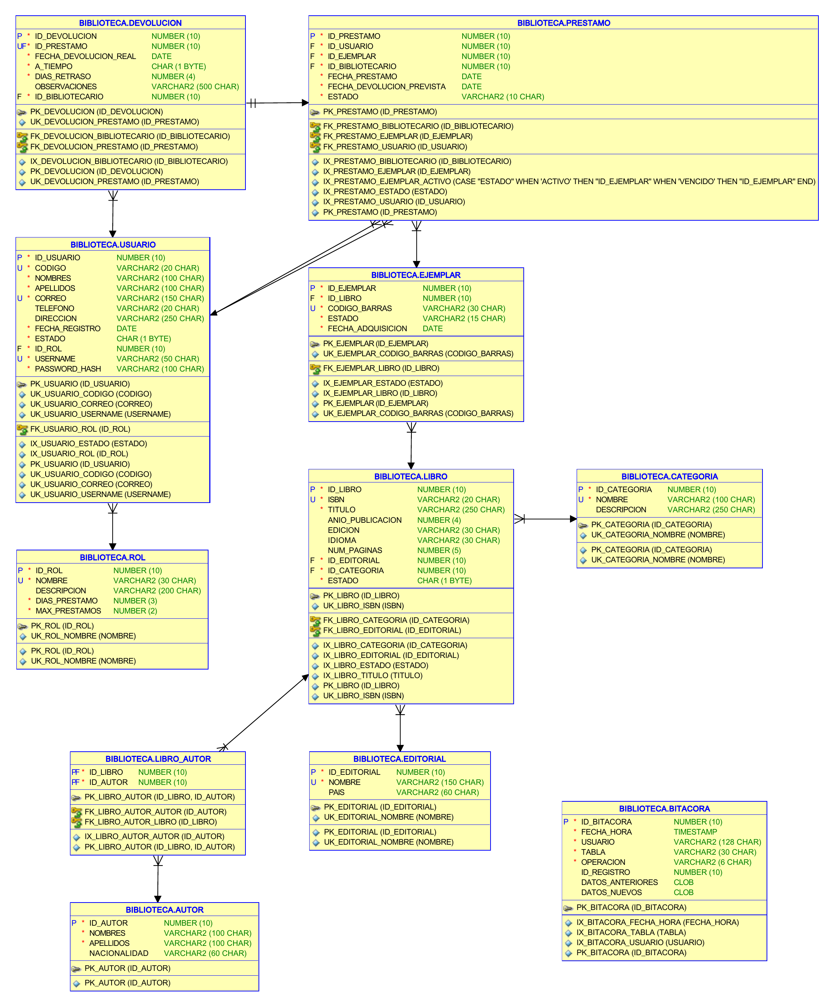

# Sistema de Gestión de Biblioteca Universitaria

Proyecto final de **Base de Datos I, sección A**. Universidad Mariano Gálvez de Guatemala. Catedrático: Ing. Ronald Ayala.

| Integrante | Carné |
|------------|-------|
| Andrés Eduardo Ambrocio Yanci | 3190-23-12570 |
| Katherine Andrea Flores Boche | 3190-23-17822 |
| Francisco Javier Moscoso Peralta | 3190-23-15016 |
| Donovan Enrique Alvarez Eguizabal | 3190-23-735 |

Base de datos Oracle con la lógica de préstamos en PL/SQL, una API en Spring Boot y una aplicación web en Angular con roles, bitácora y reportes.



## Contenido del repositorio

```
ProyectoFinal_BD1/
├── docs/                 Documento final (Word y PDF), contrato de la API y códigos de error
├── modelo/               ER oficial (Data Modeler, PDF y PNG) y diccionario de datos
├── db/                   Scripts SQL: tablas, datos, triggers, paquete PL/SQL, vistas y pruebas
├── scripts/              Comandos para levantar e instalar Oracle (.sh para macOS/Linux, .ps1 para Windows)
├── backend/              API REST en Spring Boot (puerto 8080)
├── frontend/             Aplicación web en Angular (puerto 4200)
├── docker-compose.yml    Contenedor Oracle, solo si no tienes uno
└── .env.example          Plantilla de configuración local
```

| Quiero ver… | Archivo |
|-------------|---------|
| El documento entregado | [`docs/Documentacion_Proyecto_Final_BD1.pdf`](docs/Documentacion_Proyecto_Final_BD1.pdf) |
| El diagrama ER | [`modelo/er.pdf`](modelo/er.pdf) |
| Tablas y columnas | [`modelo/diccionario_datos.md`](modelo/diccionario_datos.md) |
| Qué hace cada script SQL y las pruebas | [`db/README.md`](db/README.md) |
| Los endpoints de la API | [`docs/api.md`](docs/api.md) |
| Los errores de negocio (ORA-200xx) | [`docs/codigos_error.md`](docs/codigos_error.md) |

## Cómo levantarlo

### Requisitos
Docker Desktop (con unos 2 GB de RAM libres para Oracle), Git, JDK 21 y Node.js 20 o superior.

### Primera vez
1. Clona el repositorio:
   ```bash
   git clone https://github.com/AndresEAY/ProyectoFinal_BD1.git
   cd ProyectoFinal_BD1
   ```
2. Copia `.env.example` a `.env` y ajústalo a tu máquina (el `.env` no se sube a Git):

   | Variable | Qué poner |
   |----------|-----------|
   | `DB_CONTAINER` | Nombre de tu contenedor Oracle (`docker ps -a`) o el que se creará |
   | `DB_IMAGE` | Solo si no tienes contenedor. PC Intel/AMD: `gvenzl/oracle-xe:21-slim-faststart`. Mac con chip Apple: `gvenzl/oracle-free:23-slim` |
   | `DB_SERVICE` | `XEPDB1` para Oracle XE o `FREEPDB1` para Oracle Free |
   | `DB_PORT` | Puerto de Oracle en tu máquina, normalmente `1521` |
   | `DB_SYSTEM_PASSWORD` | Contraseña de SYSTEM de tu contenedor |
   | `APP_USER` / `APP_USER_PASSWORD` | Usuario y contraseña del esquema de la app (`BIBLIOTECA`) |

3. Crea la base de datos (en Windows usa los `.ps1`, por ejemplo `.\scripts\db-up.ps1`):
   ```bash
   ./scripts/db-up.sh            # enciende Oracle y espera a que esté listo
   ./scripts/db-create-user.sh   # crea el usuario BIBLIOTECA si no existe
   ./scripts/db-install.sh       # crea tablas, datos, triggers, paquete y vistas
   ```
4. Instala las dependencias del frontend:
   ```bash
   cd frontend && npm install
   ```

### Día a día (3 terminales)

| Terminal | Comando | Listo cuando aparece |
|----------|---------|----------------------|
| 1. Base de datos | `./scripts/db-up.sh` | `Oracle listo.` |
| 2. Backend | `cd backend && ./mvnw spring-boot:run` (Windows: `mvnw.cmd spring-boot:run`) | `Started BackendApplication` |
| 3. Frontend | `cd frontend && npx ng serve` | `Local: http://localhost:4200/` |

Abre **http://localhost:4200**. La documentación interactiva de la API está en http://localhost:8080/swagger-ui.html.

Para detener: `Ctrl + C` en las terminales 2 y 3, y `docker stop <contenedor>` para apagar Oracle.

### Otros comandos

| Para… | Comando |
|-------|---------|
| Dejar los datos como al inicio | `./scripts/db-install.sh` |
| Borrar el esquema y crearlo de nuevo | `./scripts/db-reset.sh` (no toca el contenedor ni otros esquemas) |
| Probar las reglas de negocio en Oracle (26 casos) | `./scripts/db-test.sh` |
| Probar el backend | `cd backend && ./mvnw test` |
| Abrir SQL*Plus como BIBLIOTECA (o como SYSTEM con `--system`) | `./scripts/db-sql.sh` |

## Usuarios de prueba

La contraseña de todos es **`Biblio2026`**. No es la misma que `APP_USER_PASSWORD`, que es la del esquema en Oracle.

| Usuario | Rol | Situación |
|---------|-----|-----------|
| `admin`, `admin2` | ADMIN | Acceso total, incluida la bitácora |
| `biblio1`, `biblio2` | BIBLIOTECARIO | Registra préstamos y devoluciones |
| `profesor1`, `profesor2` | PROFESOR | Con préstamos activos |
| `profesor3` | PROFESOR | Tiene un préstamo vencido |
| `estudiante1` | ESTUDIANTE | Puede pedir préstamos |
| `estudiante2` | ESTUDIANTE | Ya tiene 3 préstamos, el máximo permitido |
| `estudiante3` | ESTUDIANTE | Tiene un préstamo vencido |
| `estudiante4` | ESTUDIANTE | Sin préstamos abiertos |
| `estudiante5` | ESTUDIANTE | Inactivo: no puede entrar ni pedir préstamos |

## Si algo falla

| Síntoma | Causa y solución |
|---------|------------------|
| El backend no arranca y menciona la conexión | Oracle no está encendido: `./scripts/db-up.sh` |
| `ORA-01017` al conectar | Contraseña incorrecta en `.env`. La del esquema es `APP_USER_PASSWORD`, no `Biblio2026` |
| La app dice "No se pudo conectar con el servidor" | El backend no está corriendo |
| `Port 8080/4200 already in use` | Ya hay otra copia corriendo; ciérrala con `Ctrl + C` |
